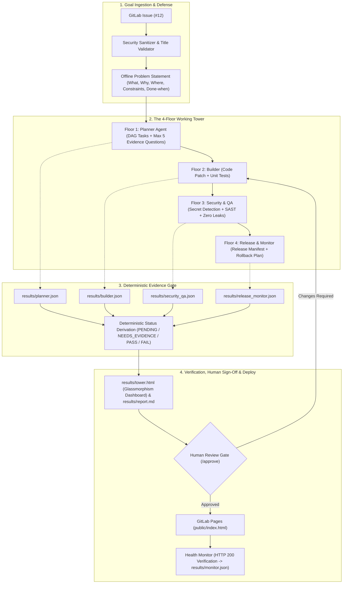
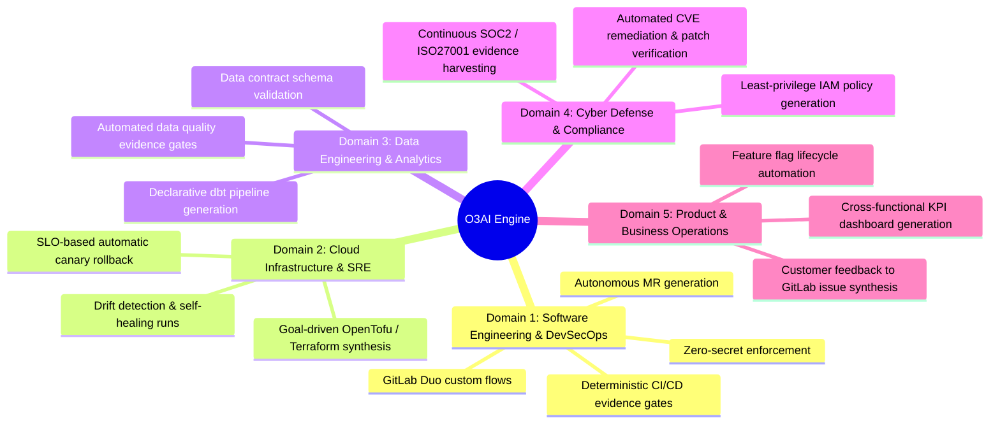

# O3AI: Optimum Objective Operational AI

> **"You give it a goal. It delivers a result."**  
> *GitLab-Native Goal-to-Result Engine for Software Engineering*

---

## 1. Problem Statement

Modern software engineering teams face three critical bottlenecks when adopting AI coding assistants:

1. **Unbounded Hallucinations & Context Drift**: Conversational AI chatbots write code without structural constraints, decomposing tasks arbitrarily and deviating from business requirements.
2. **The "Rubber Stamp" Security Risk**: AI-generated pull requests often leak hardcoded secrets, inject unvalidated input vectors, or introduce hidden regressions that slip past hurried human reviewers.
3. **Absence of Deterministic Proof**: LLMs claim code "works," but CI pipelines require deterministic, reproducible verification before any artifact reaches production.

---

## 2. Solution: The O3AI Engine

**O3AI** transforms GitLab into an autonomous, self-verifying software factory:

- **One GitLab Issue = One Goal Session**: Strict title constraints (max 35 words) and regex heuristics isolate issues into single-topic, prompt-injection-contained inputs.
- **The 4-Floor Working Tower**:
  - **Floor 1 (Planner)**: Decomposes the goal into discrete, acyclic DAG tasks and formulates at most 5 evidence questions.
  - **Floor 2 (Builder)**: Produces standard-library Python code modifications and matching unit tests.
  - **Floor 3 (Security & QA)**: Enforces zero leaked secrets, AST code hygiene, and unit test regression verification.
  - **Floor 4 (Release & Monitor)**: Compiles the release manifest, secures explicit human sign-off, and verifies live deployment health.
- **Deterministic Evidence Gating**: No floor passes based on LLM claims. Every stage derives its status strictly from verified JSON proof files in `results/<stage>.json`.
- **Enforced Human Gate**: Deployment to production remains blocked until an authorized human inspects the evidence report and signs off.

---

## 3. Real vs Simulated

To guarantee fast, 100% reproducible tests without external network dependencies, API credits, or external LLM drift:

| Component | Real (Implemented & Live) | Offline Simulation (Reproducible Tests) |
| :--- | :--- | :--- |
| **Working Tower Engine** | Full 4-floor execution contract, DAG validator, models, security checks | — |
| **Evidence Gating** | Deterministic derivation from `results/*.json` (`PENDING` / `PASS` / `FAIL`) | — |
| **GitLab CI/CD Pipeline** | 7 live stages in `.gitlab-ci.yml`, SAST, Secret Detection, Pages, Monitor | — |
| **Unit Tests** | 52 real unittest assertions executing in ~0.5s with zero external dependencies | — |
| **Duo Agent Prompt & Specs** | Validated Flow Registry YAML specs and UI system prompt ([docs/planner_agent_prompt.md](docs/planner_agent_prompt.md)) | — |
| **Duo Flow Execution Script** | — | `scripts/issue_to_mr.py` and `scripts/mr_review_comment.py` provide an offline simulation of the Duo flow for reproducible tests |
| **Health Monitor Server** | Real HTTP socketserver probe verifying status 200 OK | Probes ephemeral local port rather than cloud URL |

---

## 4. Architecture & Working Tower Workflow



---

## 5. GitLab Duo Agent Platform Specification & Offline Simulation

O3AI provides formal specification files and offline simulations for GitLab Duo:

- **Custom Agent Definition ([.gitlab/duo/flows/o3ai_planner.yml](.gitlab/duo/flows/o3ai_planner.yml))**:
  - Implements the `O3AI Planner` persona adhering to Flow Registry v1 schema.
  - Treats issue content strictly as untrusted data enclosed in safe boundary delimiters.
  - Formulates at most 5 evidence questions and decomposes work into an acyclic DAG.
- **Agent UI Prompt ([docs/planner_agent_prompt.md](docs/planner_agent_prompt.md))**:
  - Pure plain-text system prompt ready to paste directly into GitLab's Custom Agent UI.
- **Custom Flow Specification ([.gitlab/duo/flows/issue_to_mr_flow.yml](.gitlab/duo/flows/issue_to_mr_flow.yml))**:
  - Defines the YAML flow linking issue triggers to the Planner and the built-in Developer Flow.
- **Runtime Sandboxing ([.gitlab/duo/agent-config.yml](.gitlab/duo/agent-config.yml))**:
  - Configures container image, setup scripts, and strict outbound network policies.
- **Offline Simulation Script ([scripts/issue_to_mr.py](scripts/issue_to_mr.py))**:
  - Serves as an **offline simulation of the Duo flow for reproducible tests**, running the planner agent, applying the code patch, and generating MR payloads without external network calls.
- **Security & QA MR Review Bot ([scripts/mr_review_comment.py](scripts/mr_review_comment.py))**:
  - Reviews Merge Requests against security criteria and outputs `[APPROVED]` or `[CHANGES REQUIRED]` comments.

---

## 6. GitLab CI/CD Pipeline (7 Stages)

The complete pipeline is codified in [.gitlab-ci.yml](.gitlab-ci.yml):

| Stage | Script | Deterministic Evidence | Purpose |
| :--- | :--- | :--- | :--- |
| **`validate`** | [scripts/lint.py](scripts/lint.py) | `results/validate.json` | AST syntax checking and code hygiene |
| **`test`** | [scripts/test_runner.py](scripts/test_runner.py) | `results/test.json` | Automated discovery and execution of 52 unit tests |
| **`security`** | [scripts/security_check.py](scripts/security_check.py) | `results/security.json` | Scans for leaked secrets and unsafe Python invocations |
| **`tower-report`** | [scripts/tower_report_job.py](scripts/tower_report_job.py) | `results/tower_report.json` | Compiles `tower.html` and `report.md` |
| **`approve`** | [scripts/approve.py](scripts/approve.py) | `results/approve.json` | Blocking human-in-the-loop sign-off |
| **`deploy`** | [scripts/deploy_pages.py](scripts/deploy_pages.py) | `results/deploy.json` | Publishes dashboard to GitLab Pages (`public/index.html`) |
| **`monitor`** | [scripts/health_check.py](scripts/health_check.py) | `results/monitor.json` | Performs live HTTP GET probe and verifies DOM title |

---

## 7. How to Run

### System Requirements
- **Python 3.12+**
- **Standard Library Only**: Zero external `pip` dependencies.

### 1. One-Command Automated Demo Run
```powershell
python scripts/run_demo.py
```

### 2. Interactive Demo with Pauses for Narration
```powershell
python scripts/run_demo.py --interactive
```
### 3. Reset Demo to Initial Broken Baseline
```powershell
python scripts/demo_reset.py
```

### 4. Run the Full 7-Stage CI Pipeline Locally
```powershell
python scripts/run_pipeline.py
```

### 5. Run the Entire Test Suite (52 Tests)
```powershell
python -m unittest discover -s tests -p "test_*.py" -v
```

### 6. O3AI CLI Interface
```powershell
# Initialize a new Goal Session
python -m o3ai.cli init-session --issue-id 12 --title "Add input validation to signup" --description "Enforce email and password rules."

# Generate Working Tower reports
python -m o3ai.cli generate-report
```

---

## 8. Current Limitations

1. **Python Standard Library Constraint**: Core engine relies strictly on Python 3.12+ built-in modules (`json`, `re`, `urllib`, `socketserver`, `unittest`, `dataclasses`). External database drivers and heavy web frameworks are intentionally excluded.
2. **Single-Topic Issue Boundary**: Goal sessions enforce a strict 35-word limit and reject multi-topic conjunctions (`furthermore; separately`). Multi-epic goals must be split across individual issues.
3. **Local HTTP Probing in Monitor Stage**: The built-in monitor stage spins up a local `socketserver` to probe GitLab Pages artifacts. In enterprise production, this binds to GitLab Environment URLs and external synthetic monitoring APIs.

---

## 9. Roadmap & The 5-Domain Vision

While the hackathon implementation focuses on software engineering on GitLab, O3AI is architected around a unified **5-Domain Operational AI Vision**:



### Strategic Milestones
- **v1.1 (Next Release)**: Native GitLab Duo Studio Webview plugin for inline Working Tower floor visualization.
- **v1.2**: GitLab Model Context Protocol (MCP) server for real-time Duo Chat tower querying.
- **v2.0**: Multi-repository federated Working Towers with cross-project dependency DAG resolution.
- **v3.0**: Generalization into Cloud SRE (Domain 2) and Automated Compliance (Domain 4).

---

## 10. License

This project is licensed under the MIT License - see the [LICENSE](LICENSE) file for details.
