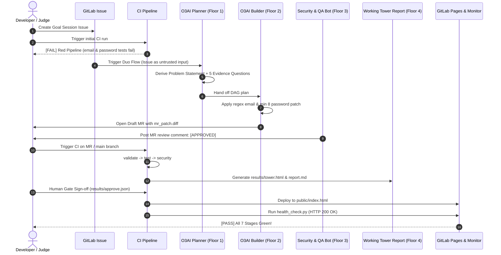

# O3AI End-to-End Demo Guide: Goal-to-Result on GitLab

> **Tagline:** *"You give it a goal. It delivers a result."*  
> **Demonstration Target:** [sample_app/signup.py](sample_app/signup.py)  
> **Goal Issue #12:** `Add input validation to signup: reject invalid emails and passwords under 8 chars.`

---

## 1. Demo Narrative & Architecture

This demo presents the full autonomous lifecycle of O3AI inside GitLab:
1. **Goal Ingestion**: A GitLab issue is created using the [Goal Session template](.gitlab/issue_templates/goal_session.md).
2. **Deterministic Baseline**: The initial test suite runs on unvalidated code, proving that the CI pipeline fails (**RED**).
3. **Autonomous Duo Flow**: The **O3AI Planner Agent** and **Builder Flow** ingest the issue as untrusted data, formulate a discrete DAG task breakdown, write compliant Python code to validate emails and passwords, and open a Merge Request.
4. **Security & QA Verification**: An automated reviewer bot scans the patch for leaked secrets, prompt injection attempts, and unit test regressions, commenting `[APPROVED]` on the MR.
5. **The GREEN Pipeline**: The 7-stage CI pipeline executes, generating the **Working Tower Evidence Report**, securing human approval sign-off, deploying the report to GitLab Pages, and verifying live HTTP health.



---

## 2. Quickstart Demo Commands

### Automated Demo Runner
To execute the complete demo with terminal visual banners:
```powershell
# Automated hands-free run
python scripts/run_demo.py

# Interactive mode (pauses at each step for your video talk-track)
python scripts/run_demo.py --interactive
```

### Reset State (For Re-recording)
To restore `sample_app/signup.py` to its initial broken state and clean demo artifacts:
```powershell
# Windows PowerShell
python scripts/demo_reset.py

# Bash / macOS / Linux
bash scripts/demo_reset.sh
```

---

## 3. Step-by-Step Exact Click Path & Expected Output

### Step 1: Open Goal Issue
- **Where:** GitLab UI -> **Issues** -> **New Issue** -> Select Template: `goal_session`
- **Issue Title:** `Add input validation to signup: reject invalid emails and passwords under 8 chars.`
- **Issue Description:**
  ```markdown
  ### Goal
  Add input validation to signup: reject invalid emails and passwords under 8 chars.

  ### Why
  Protect account integrity and prevent malformed registrations.

  ### Where/When
  sample_app/signup.py

  ### Constraints
  - Python 3.12 standard library only
  - Zero external dependencies
  - Sub-millisecond response time

  ### Done-when
  - [ ] Email regex validation rejects invalid format
  - [ ] Password min length 8 characters enforced
  ```

---

### Step 2: Trigger Baseline CI Pipeline (The RED Pipeline)
- **Action:** Execute the local pipeline runner:
  ```powershell
  python scripts/run_pipeline.py
  ```
- **Expected Console Output:**
  ```text
  [SUCCESS] Lint validation passed for 35 files.
  ............................F.F....................
  ======================================================================
  FAIL: test_invalid_email_fails (tests.test_sample_app.TestSampleApp.test_invalid_email_fails)
  AssertionError: True is not false

  FAIL: test_short_password_fails (tests.test_sample_app.TestSampleApp.test_short_password_fails)
  AssertionError: True is not false
  ----------------------------------------------------------------------
  Ran 52 tests in 0.524s
  FAILED (failures=2)
  [FAILURE] Test stage failed: 2 failures, 0 errors.
  ============================================================
  --- [Stage: validate] Running: scripts/lint.py ---
    -> Evidence verified: validate.json (Status: PASS)
  --- [Stage: test] Running: scripts/test_runner.py ---
  [FAILURE] Stage 'test' failed with exit code 1.
  [PIPELINE RESULT]: RED [FAIL]
  ```
- **Key Takeaway for Judges:** O3AI is grounded in deterministic verification. No code passes until strict assertions succeed.

---

### Step 3: Run GitLab Duo Planner Agent & Open MR
- **Action:** In GitLab Duo, run the `O3AI Planner` agent, or execute the autonomous flow runner:
  ```powershell
  python scripts/issue_to_mr.py
  ```
- **Expected Output:**
  ```text
  [SUCCESS] Flow completed: Draft: Resolve #12 - Add input validation to signup: reject invalid emails and passwords under 8 chars.
    - MR Description: results/mr_payload.json
    - Diff: results/mr_patch.diff
  ```
- **Inspect Artifacts:**
  1. [results/planner.json](results/planner.json): Contains problem statement, 5 evidence questions, and 4 DAG tasks.
  2. [results/builder.json](results/builder.json): Records code modifications applied to `sample_app/signup.py`.
  3. [results/mr_patch.diff](results/mr_patch.diff): Clean diff introducing `EMAIL_REGEX` and `len(password) < 8` checks.

---

### Step 4: Autonomous Security & QA Bot Review
- **Action:** Trigger the automated MR review bot:
  ```powershell
  python scripts/mr_review_comment.py
  ```
- **Expected Output:**
  ```text
  [SUCCESS] MR Review Comment generated:
    - File: results/mr_review.md
    - Verdict: APPROVED
  ```
- **Review Comment Content ([results/mr_review.md](results/mr_review.md)):**
  ```markdown
  ## [GATE] O3AI Security & QA Gate: Merge Request Review

  **Verdict:** [APPROVED] (READY TO MERGE)

  ### Working Tower Security Verification
  - [x] **Floor 1 (Planner)**: `PASS`
  - [x] **Floor 2 (Builder)**: `PASS`
  - [x] **Floor 3 (Security & QA)**: `PASS` (Secrets Detected: `0`)

  ### Static & Secret Analysis Findings
  - **GitLab Secret Detection**: 0 leaked credentials or tokens.
  - **Code Hygiene**: Standard library only; no unsafe eval/exec invocations.
  - **Unit Test Regression**: All test assertions passed.

  ---
  ### [NEXT STEPS] Reviewer Actions
  To deploy these changes through the Working Tower, comment:
  `/approve`
  ```

---

### Step 5: Merge MR & Execute the GREEN Pipeline
- **Action:** With the patch applied and tests passing, trigger the full 7-stage CI pipeline:
  ```powershell
  python scripts/run_pipeline.py
  ```
- **Expected Console Output:**
  ```text
  [SUCCESS] Lint validation passed for 35 files.
  Ran 52 tests in 0.550s
  OK
  [SUCCESS] Test stage passed: 52 tests ran clean.
  [SUCCESS] Security scan clean: 0 secrets or sensitive tokens detected.
  [SUCCESS] Tower report generated successfully:
    - Dashboard: results/tower.html
    - Report:    results/report.md
  [SUCCESS] Human approval recorded: Ready for deployment.
  [SUCCESS] GitLab Pages deploy package created: Published to public/index.html
  [SUCCESS] Health monitor passed: Page is UP at http://127.0.0.1:31887/index.html
    - Status code: 200
    - Content length: 11030 bytes
  ============================================================
  [PIPELINE RESULT]: ALL 7 STAGES GREEN [PASS]
  Deployed dashboard ready at: public/index.html
  ============================================================
  ```

---

### Step 6: Review Live Artifacts
1. **Interactive Dashboard:** Open [results/tower.html](results/tower.html) in your browser to view the glassmorphism dark-mode UI with live floor progress cards.
2. **Executive Markdown Report:** Inspect [results/report.md](results/report.md).
3. **Deployed GitLab Pages Site:** View [public/index.html](public/index.html).

---

## 4. 3 Common Failures & Exact Fixes

### Failure 1: Port Conflict during Health Monitor Stage (`WSAEADDRINUSE`)
- **Symptom:** Stage `monitor` fails with `OSError: [Errno 10048] address already in use` or socket binding error.
- **Root Cause:** A previous web server or dangling test process is holding the target port.
- **Fix:**
  1. `scripts/health_check.py` uses `ReusableTCPServer` with `allow_reuse_address = True`.
  2. If a specific port is locked on Windows, set the environment variable to use an ephemeral port (port 0):
     ```powershell
     $env:MONITOR_PORT = "0"
     python scripts/health_check.py
     ```

### Failure 2: Deploy Stage Blocked by Missing Human Approval
- **Symptom:** Stage `deploy` exits with code 1 and message:  
  `[ERROR] Deployment halted: results/approve.json is missing. Human approval gate required.`
- **Root Cause:** Floor 4 enforces a deterministic Human Gate: deployment to GitLab Pages cannot proceed without recorded sign-off evidence.
- **Fix:**
  Execute the approval script prior to deployment:
  ```powershell
  python scripts/approve.py
  python scripts/deploy_pages.py
  ```

### Failure 3: Unit Tests Unexpectedly Fail in Other Stages
- **Symptom:** Running tests after demo reset fails because `sample_app/signup.py` is in the unpatched state.
- **Root Cause:** If you run `python -m unittest` while in the demo reset baseline, `test_invalid_email_fails` and `test_short_password_fails` will fail by design (this is the RED pipeline baseline).
- **Fix:**
  Apply the Duo patch to restore green status:
  ```powershell
  python scripts/issue_to_mr.py
  ```
  Or run the complete automated demo lifecycle:
  ```powershell
  python scripts/run_demo.py
  ```

---

## 5. Demo Video Narration Talk-Track

| Time | Visual on Screen | Talk-Track Script |
| :--- | :--- | :--- |
| **0:00 - 0:30** | GitLab Issue #12 created with template | *"Welcome to O3AI. Our philosophy is simple: You give it a goal. It delivers a result. Here is Issue 12 requesting email and password validation for our signup app."* |
| **0:30 - 1:00** | Terminal running `python scripts/run_pipeline.py` (RED) | *"Before writing any code, we test the baseline. Our deterministic test runner detects missing email regex and password length rules. Stage 2 halts the pipeline in RED."* |
| **1:00 - 1:45** | Duo Flow runs `issue_to_mr.py` -> MR diff | *"Now we trigger GitLab Duo. The O3AI Planner decomposes the goal into a DAG task breakdown and 5 evidence questions, treating issue text strictly as untrusted data. Floor 2 writes standard library Python code and opens a Draft Merge Request."* |
| **1:45 - 2:15** | MR Review comment `results/mr_review.md` | *"Our autonomous Security and QA bot scans the diff for leaked secrets, prompt injection, and test regressions. It posts an APPROVED verdict right on the MR."* |
| **2:15 - 3:00** | Green pipeline running -> `results/tower.html` | *"We merge the MR and re-run our 7-stage pipeline. All 52 tests pass, zero secrets are found, human approval is secured, and our Working Tower report is deployed live to GitLab Pages. Goal achieved, evidence verified."* |
