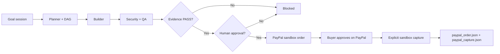
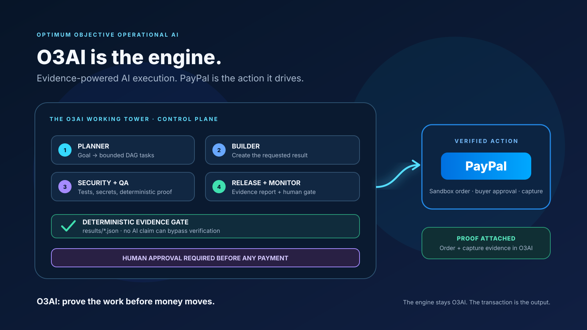

# O3AI: the engine that proves work before money moves

O3AI's name and core are preserved: a bounded goal session flows through Planner → Builder → Security & QA → Release & Monitor, backed by deterministic evidence and human approval. PayPal is an optional sandbox execution adapter powered by the engine—not a replacement for it.



## Optional live AI planner

O3AI can use an OpenAI-compatible LLM as a **proposal generator**. The result is framed as untrusted input, parsed as strict JSON, limited to 20 tasks/five evidence questions, and checked for valid dependencies and DAG cycles. It is stored with `PROPOSAL_ONLY`; it cannot mark Tower evidence PASS or authorize payments. Existing deterministic planning and tests remain available without model credentials.

```sh
export O3AI_AI_API_KEY='your-provider-key'
export O3AI_AI_MODEL='your-model-name'
# Optional for an OpenAI-compatible provider other than OpenAI:
export O3AI_AI_BASE_URL='https://your-provider.example/v1'
python scripts/ai_plan.py --goal 'Verify a completed software milestone before issuing a test payment'
```

Do not commit provider API keys. The live AI API is a separate service and may incur costs; use a provider/model for which you have permission and budget.

## PayPal sandbox flow

Create a sandbox REST app in the PayPal Developer Dashboard. Use its sandbox Client ID and Secret and a sandbox Personal buyer account. The code only calls `https://api-m.sandbox.paypal.com`; it does not support live PayPal hosts.

```sh
export PAYPAL_CLIENT_ID='your-sandbox-client-id'
export PAYPAL_CLIENT_SECRET='your-sandbox-secret'
python -m unittest tests.test_paypal tests.test_ai_planner -v
```

The order action is blocked unless all four O3AI floor evidence files (`planner.json`, `builder.json`, `security_qa.json`, `release_monitor.json`) contain passing, structurally valid proof, and `approve.json` records a passing approval stage. The command also requires a person to type `APPROVE` at the terminal.

```sh
python scripts/paypal_demo.py create-order --amount 25.00 --currency USD --description 'Verified work milestone'
```

Open the printed approval URL and sign in with the sandbox Personal buyer account to approve the order. The buyer's PayPal approval is separate from O3AI's approval gate. Capture is a second explicit action and rechecks the full O3AI gate:

```sh
python scripts/paypal_demo.py capture-order --order-id ORDER_ID_PRINTED_ABOVE
```

The capture command also requires typed `APPROVE`. Only a completed PayPal capture is written as successful in `results/paypal_capture.json`; order and capture evidence are saved separately. Verify the test transaction in the sandbox Business account. No real money is moved.

## Visual architecture



## Hackathon framing

**O3AI — Optimum Objective Operational AI: prove the work before money moves.** Demonstrate the existing goal-to-result engine, its four evidence-backed floors and human gate, an optional live model-generated plan, then a buyer-approved PayPal sandbox order and captured-payment proof. The AI plan is not misrepresented as a live code-writing agent, and the existing simulated GitLab Duo flow remains clearly labeled as simulation.
