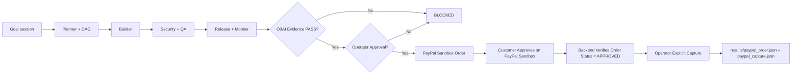

# O3AI: The Engine That Proves Work Before Money Moves

O3AI (**Optimum Objective Operational AI**) is the engine and control plane: a bounded goal session flows through **Planner → Builder → Security & QA → Release & Monitor**, backed by deterministic evidence in `results/*.json` and explicit human approval. PayPal Sandbox is an optional downstream action driven by O3AI—never a replacement for it.



## Architecture Boundaries

- **Offline Core (`o3ai/`)**: Goal sessions, untrusted input framing, DAG validation, deterministic evidence derivation, and reports. Contains zero network clients or servers and never imports `integrations/` (enforced by `tests/test_core_boundary.py`).
- **External Integrations (`integrations/`)**:
  - `integrations/paypal.py`: Sandbox-only PayPal REST client fixed to `https://api-m.sandbox.paypal.com` (live hosts are not configurable).
  - `integrations/ai_planner.py`: Optional HTTPS-only OpenAI-compatible planner proposal client.
  - `integrations/web_app.py`: Local operator console and customer page server. It drives the PayPal and AI clients, so it lives outside the core.
- **Offline Simulation (`scripts/issue_to_mr.py`)**: Labeled **SIMULATION — NO PAYPAL REQUEST**. Reproduces the GitLab Duo Issue-to-MR workflow locally for deterministic tests and never interacts with PayPal.

## PayPal Sandbox Account & App Setup

1. Sign in to the [PayPal Developer Dashboard](https://developer.paypal.com/dashboard/).
2. Under **Sandbox → Accounts**, note or create:
   - A **Business** (merchant/seller) sandbox account for the REST app.
   - A **Personal** (buyer) sandbox account for approving checkout orders.
3. Under **Apps & Credentials → Sandbox**, create a REST app linked to your Sandbox Business account and copy its **Client ID** and **Secret**.

## Local Setup

Use environment variables only (never commit `.env` or real credentials; `.gitignore` excludes `.env` and `.env.*`):

```powershell
$env:PAYPAL_CLIENT_ID = "<your-sandbox-client-id>"
$env:PAYPAL_CLIENT_SECRET = "<your-sandbox-secret>"
# Optional fixed operator token (if omitted on localhost, a random token is printed on startup):
$env:O3AI_OPERATOR_TOKEN = "<your-local-operator-token>"
```

Optional AI planner proposal configuration (HTTPS only):

```powershell
$env:O3AI_AI_API_KEY = "<your-ai-key>"
$env:O3AI_AI_MODEL = "<your-model-name>"
$env:O3AI_AI_BASE_URL = "https://api.openai.com/v1"
```

## Web UI Routes & Role Separation

Start the local web server (binds to `127.0.0.1:8080` by default; non-loopback hosts are refused unless `O3AI_OPERATOR_TOKEN` is set):

```powershell
python scripts/run_web_ui.py
```

- **`/` — Developer / Operator Console**:
  - Displays Goal Session, all 4 Working Tower floors (`Planner`, `Builder`, `Security & QA`, `Release & Monitor`) with derived statuses from `results/*.json`, and overall `READY` / `BLOCKED` state with exact reasons.
  - Requires operator authentication (`O3AI_OPERATOR_TOKEN` + `HttpOnly; SameSite=Strict` cookie + `X-CSRF-Token` + same-origin check) for any mutating action.
  - Distinctly displays **PayPal Order State**, **Buyer Approval State** (PayPal), and **Capture State**, plus the **Activity & Evidence Trail** tying `session_id` to `order_id` and `capture_id`.
  - Optionally generates an AI proposal (`results/ai_plan.json`) marked `PROPOSAL_ONLY — NOT EVIDENCE`.
- **`/customer` — Customer Milestone Checkout**:
  - Read-and-proceed customer page showing milestone title, description, amount, currency, and O3AI gate state.
  - Blocks checkout until all 4 Tower floors, operator approval, and an active PayPal Sandbox order exist.
  - Opens PayPal's own Sandbox approval URL (`https://www.sandbox.paypal.com/...`); never imitates PayPal's checkout UI and cannot approve O3AI gates or trigger capture.
  - On return (`?paypal=return&token=...`), asks the backend to verify order status with PayPal (`GET /v2/checkout/orders/{order_id}`) and confirms whether the buyer approved.

## Step-by-Step Demo Flow

1. **Blocked Baseline**: Start `python scripts/run_web_ui.py` with empty `results/` (or after `python scripts/demo_reset.py`). Open `http://127.0.0.1:8080/` and `http://127.0.0.1:8080/customer` to show `BLOCKED` status—no fake `PASS` data is fabricated.
2. **Run O3AI Verification**: Run `python scripts/run_demo.py` (offline Duo simulation + 7-stage verification pipeline) or generate real floor evidence in `results/*.json`. Refresh `/` to see all 4 floors `PASS`.
3. **Operator Sign-In & Approval**: Enter the operator token in the Operator Console, type `APPROVE`, and click **Approve O3AI Gate**. To decline instead, type `REJECT` (with an optional reason) and click **Reject O3AI Gate**: this records a `FAIL` decision in `results/approve.json` and blocks order creation and capture until an explicit re-approval.
4. **Create PayPal Sandbox Order**: Configure milestone amount/currency/description, type `APPROVE`, and click **1. Create Sandbox Order** (or run `python scripts/paypal_demo.py create-order --amount 25.00 --currency USD --description "Verified milestone"`).
5. **Customer Buyer Approval on PayPal Sandbox**: Open `http://127.0.0.1:8080/customer`, click **Continue to PayPal Sandbox**, and approve using the **Sandbox Personal buyer** account. PayPal returns to `/customer?paypal=return&token=...` and backend verifies `order_status == APPROVED`.
6. **Explicit Operator Capture**: Back on `/`, confirm **Buyer Approval State** is `APPROVED`, type `APPROVE`, and click **3. Capture Approved Order**. O3AI rechecks all 4 Tower floors, checks approval freshness, calls PayPal Sandbox capture, and writes `results/paypal_capture.json` only if PayPal returns `COMPLETED`.
7. **Verify in Sandbox Business Account**: Confirm the test transaction in the Sandbox Business account activity view.

## Testing & Limitations

- Automated tests (`tests/test_paypal.py`, `tests/test_ai_planner.py`, `tests/test_web_app.py`) use mocked PayPal and AI responses and verify gate enforcement, auth/CSRF, role boundaries, error paths, and no-fake-PASS guarantees. Mocked tests do **not** prove a live PayPal Sandbox transaction; a real sandbox checkout requires sandbox app credentials and a sandbox Personal buyer login.
- Local demo binds to `127.0.0.1` over HTTP (`http://127.0.0.1:8080`); public hosting requires HTTPS/TLS termination and setting a strong `O3AI_OPERATOR_TOKEN`.
